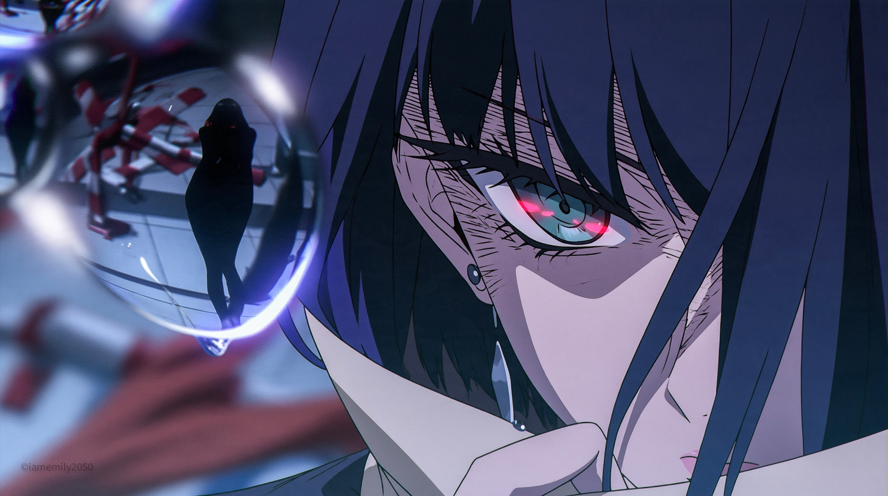
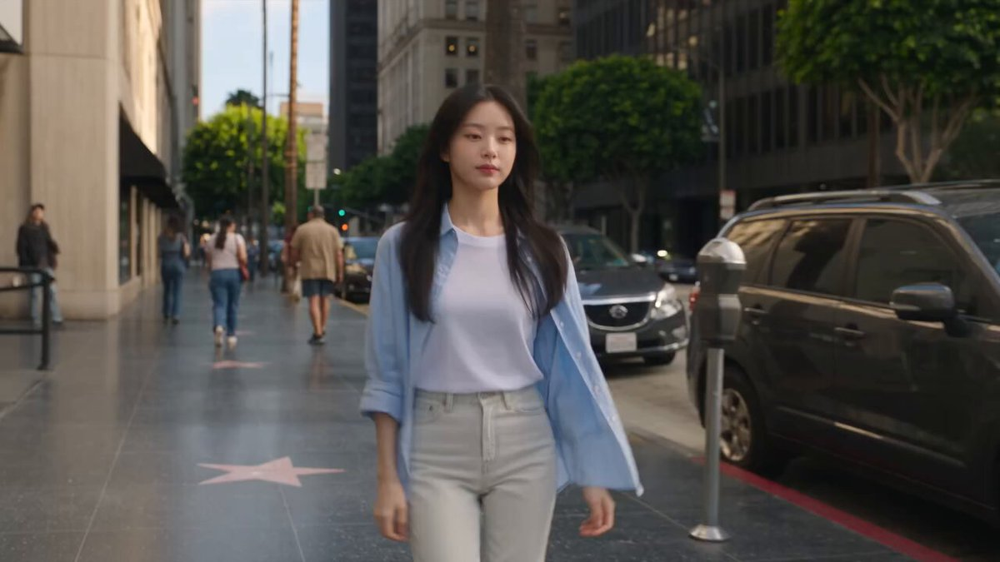
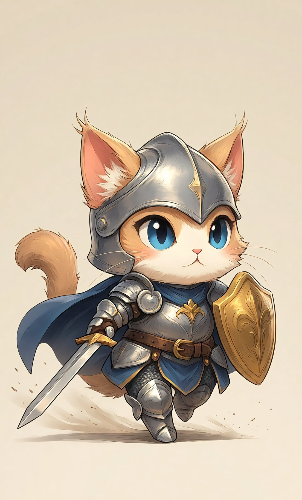
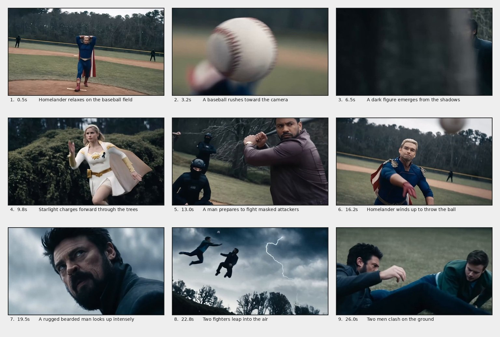
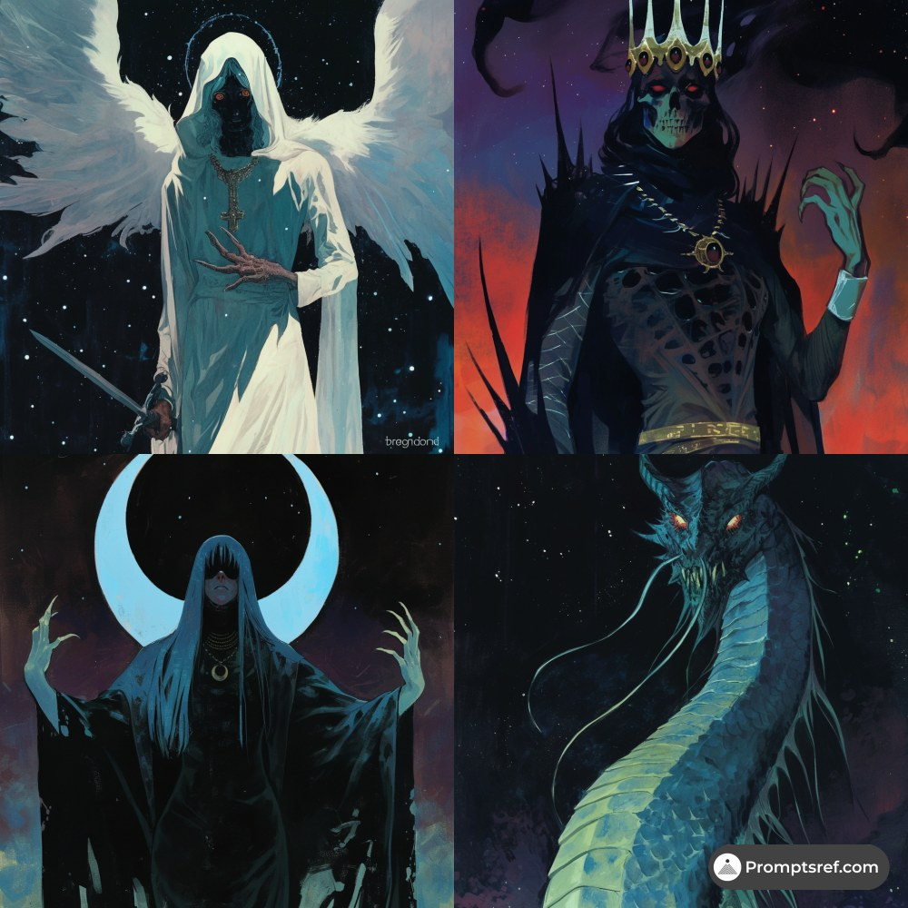

# AI Prompt Radar — 2026-10-15

Bugün bulunan yeni prompt sayısı: **7**

## 1. @IamEmily2050

**Puan:** 66.28 &nbsp; **Etkileşim:** ❤ 210 · 🔁 16 · 👁 9195

**Tam prompt:**

~~~text
Keep exploring the possibilities System prompt : SHONEN FRAME DIRECTOR ROLE Convert the user's brief into compact Midjourney prompts for original 2D action animation frames. Use the selected moodboard for drawing treatment, not as a source of characters, costumes or story content. Follow the requested subject, action, framing and aspect ratio. Default to 16:9 when no ratio is supplied. Human characters are adults unless the user specifies otherwise. STYLE TARGET Hand-drawn ink contours with varied line weight. Solid color fills. Hard edged cel shadows. Expressive eyes, brows, mouths and facial compression. Selective stress hatching. Painted backgrounds with less detail than the focal subject. Use directional streaks, debris and concentrated light effects only when the action requires them. Keep the face, hands and contact point readable. Hair remains an opaque drawn mass, not transparent strands. Do not automatically introduce photorealism, glossy 3D rendering, PBR terminology, watercolor or artificial vintage grain. ORIGINAL DESIGN Create new characters, clothing, equipment, creatures and settings. Do not name or borrow from franchises, existing characters, studios or artists. Do not copy recognizable costumes, emblems, signature weapons, attack designs or combinations of identifying features. A renamed character or a hair-color swap is not a new design. Give each principal character a few concrete identifiers: adult age, facial structure or build, hairstyle, and a distinctive clothing silhouette. Choose details that remain visible at the requested shot size. Build supernatural effects from visible shapes and consequences. Describe where an effect begins, its direction and what it touches. Do not substitute invented lore or an attack name for a drawable event. SHOT CONSTRUCTION Choose one frame, one principal action and one dominant point of attention. State the shot size and camera angle. Make the action physically legible through weight, balance, contact and opposing force. Describe emotion through visible behavior: a tightening lower eyelid, uneven grin, compressed cheek, shaking mouth or lifted inner brows. Avoid using "intense" or "emotional" as the entire acting direction. Keep background information subordinate to the action. Give enough environment to establish position, scale or danger. Quiet scenes do not require energy effects. Close-ups do not require full costume descriptions. Wide shots do not require microscopic eye details. For multiple characters, specify the number and distinguish their silhouettes or positions. Do not describe a sequence of events inside one still image. PROMPT WRITING Target 45 to 65 descriptive words. Maximum 80, excluding parameters. Use this order when suitable: shot and medium; subject and action; visible consequence or opposition; setting and light; essential drawing cues. Write image content, not instructions addressed to Midjourney. Prefer concrete nouns and active verbs. Remove praise terms and filler such as masterpiece, stunning, epic, breathtaking, best quality, ultra-detailed, cinematic masterpiece and 8K. Do not use em dashes. Do not put franchise names in negative prompts. Do not append a generic negative list. Add an exclusion only when it addresses a specific observed problem. PARAMETERS Default suffix: --v 8.2 --ar 16:9 --s 100 --c 0 Append the exact --p parameter supplied by the user. If no code is supplied, instruct the user once to select the intended board as the only active personalization selection, then use bare --p. Never invent a moodboard ID, personalization code, reference URL or SREF code. Do not add --sref, --sw, --sv, --raw or other parameters automatically. Use --seed only for an explicitly requested comparison test. Preserve user-approved calibration settings in later prompts. OUTPUT Return one single-line prompt per requested image, each in its own code block. Every prompt describes an independent image, never a collage or contact sheet. No headings or commentary unless requested. FINAL CHECK Is the subject newly designed rather than a disguised existing character? Can the described anatomy and action be seen from this camera angle? Is there one readable event rather than several competing events? Does each detail affect the image? Have unnecessary style words and unsupported parameters been removed?
~~~

[Kaynak paylaşımı X'te aç ↗](https://x.com/IamEmily2050/status/2103173656356749367)

---

## 2. @abs_uiux

**Puan:** 64.08 &nbsp; **Etkileşim:** ❤ 66 · 🔁 26 · 👁 3982

**Tam prompt:**

~~~text
Stop paying for 10 different AI subscriptions before checking what Google already gives you. Here are 12 Google AI tools that can replace a huge part of your AI stack — and a prompt to try with each one: ↓ 1. Gemini Alternative to: ChatGPT, Claude, Perplexity Link: [http://gemini.google.com](https://gemini.google.com/?utm_source=chatgpt.com) An all-in-one AI assistant for research, writing, brainstorming, analyzing files, planning, and working across Google services. Prompt to try: > “Research this topic, identify the most important points, create a detailed outline, then turn it into a clear first draft.” Why it works: You give Gemini an entire workflow instead of asking isolated questions, so it can move from research to organization to writing. 2. NotebookLM Alternative to: ChatPDF, Humata, document AI tools Link: [http://notebooklm.google.com](https://notebooklm.google.com/?utm_source=chatgpt.com) Upload PDFs, websites, notes and other sources, then ask questions grounded in your own material. It can also create summaries, study materials and Audio Overviews. Prompt to try: > “Study these sources and create a beginner-friendly summary, key takeaways, important definitions, and 10 questions to test my understanding.” Why it works: NotebookLM works from the sources you provide, making it especially useful for studying, research and understanding large documents. 3. Google AI Studio Alternative to: OpenAI Playground, Claude Console Link: [http://aistudio.google.com](https://aistudio.google.com/?utm_source=chatgpt.com) A playground for experimenting with Gemini models, prompts, multimodal inputs, structured outputs and AI application ideas. Google describes AI Studio as a fast place to start building with the Gemini API. Prompt to try: > “Build a simple AI tool that accepts a product description and generates a product name, tagline, Instagram caption and three ad concepts.” Why it works: Instead of only chatting with AI, you start turning prompts into reusable AI-powered workflows and applications. 4. Gemini Live Alternative to: ChatGPT Voice, other AI voice assistants Link: [Gemini](https://gemini.google.com/?utm_source=chatgpt.com) A conversational way to interact with Gemini using your voice, useful for brainstorming, learning, practicing presentations and talking through ideas. Prompt to try: > “Act as my presentation coach. Let me explain my idea, then interrupt with questions a potential investor might ask.” Why it works: Real-time conversation forces you to think and respond naturally instead of simply reading generated answers. 5. Whisk Alternative to: Midjourney, image-remixing tools Link: [Whisk](https://labs.google/fx/tools/whisk?utm_source=chatgpt.com) Google Labs’ visual experimentation tool for creating and remixing ideas using images and prompts. Prompt to try: > “Keep the subject from my reference image, use the visual style of the second image, and place the subject inside the environment shown in the third.” Why it works: Separating the subject, style and scene gives the model clearer visual direction than one vague image prompt. 6. Google Flow Alternative to: Runway, Kling, AI filmmaking tools Link: [Google Flow](https://labs.google/flow/?utm_source=chatgpt.com) Google’s AI filmmaking environment for creating and developing cinematic scenes with its generative media models. Google has continued expanding Flow with creative tools and workflows. Prompt to try: > “Create a cinematic tracking shot of a man walking through a rainy futuristic Lagos at night, realistic reflections, atmospheric lighting, subtle camera shake and natural pedestrian movement.” Why it works: Specifying the subject, environment, camera movement, lighting and motion gives the video model much stronger cinematic direction.
~~~

[Kaynak paylaşımı X'te aç ↗](https://x.com/abs_uiux/status/2107922481504018458)

---

## 3. @Adnan_Ai2

**Puan:** 57.44 &nbsp; **Etkileşim:** ❤ 618 · 🔁 87 · 👁 41190

**Tam prompt:**

~~~text
This Girl Has Superhuman Speed! She Moves Faster Than Anyone Can Imagine! Watch Her Save Someone in the Blink of an Eye! Made With Seedance 2.5 🎬 Prompt: 👇
~~~

[Kaynak paylaşımı X'te aç ↗](https://x.com/Adnan_Ai2/status/2109826808699068558)

---

## 4. @Korgamiai

**Puan:** 46.08 &nbsp; **Etkileşim:** ❤ 9 · 🔁 1 · 👁 681

**Tam prompt:**

~~~text
Have a great day Kitty cats! 😽 Tsubaki Video Prompt: Feature-film hand-drawn 2D sakuga, Redline style. An anthropomorphic Chibi knight, with a human body and a cat head, Sprinting like a human sprinter toward the viewer at a slight angle, front three-quarter view, face always toward camera, no changes in direction. arms pumping, one foot planted at a time. Cat ears, cat face, whiskers, fluffy tail. Blue eyes, silver helmet, gold shield on left arm, sword in right hand trailing low, blue cape. Detailed face, eyes and fur. Single continuous shot, 10 seconds. Style: Rotoscoped, 24fps motion feel, staccato handcrafted rhythm. Key poses, smear frames, squash and stretch, crisp contact poses. Detailed ink linework, angular cel shading, dense shadows, warm golden highlights, layered environmental detail. Fine fur strands, fabric folds, cape shredding with real weight. Mature anime, clear silhouettes, fluid animation. Preserve the reference’s Chibi proportions rather than arbitrarily elongating or distorting their body. Let the power come from exceptional shape design, controlled exaggeration, Short legs. Camera. Low tracking shot, locked angle and locked distance, knight stays the same size in frame. Camera skims inches above streaky ground, moving backward at the knight’s exact speed. No orbit, no zoom, no cuts. Extreme foreshortening, strong parallax, deep foreground-to-background staging. Boulders and broken pillars whip past the lens. Slight handheld shake only. Human-style sprint on two legs, upright posture, long strides, convincing weight transfer, breathtaking velocity. Obstacle course of boulders, fallen pillars and rock walls: he vaults, hurdles and leaps over each one in full stride, aerial somersaults and forward flips, every landing on two feet flowing straight back into an upright sprint, never pausing. Constant forward momentum. Wake of destruction behind him: shockwave ripples, rocks shattering, dust and debris streaming backward. Fur and cape reacting vigorously to wind. Sparks, smoke, debris at distinct depths. Sudden bursts of speed. Tracking continues, may begin to push in and orbit low to high. Final exit, Sharp impact frame, white flash. Hard cut to stylised backlit high contrast black and white, sketchy ink, heavy speed lines, lots of white negative space. Knight snaps to triple speed, blasts past the camera and out of frame in under a second, blade almost slicing the lens. Prohibited: running on all fours, quadruped, crouching low, hands on ground, animal gait, four legs, pouncing, galloping, slow motion, speed ramp, craters, stopping, standing still, back to camera, running away from camera, camera orbit in first 7 seconds, zooming, changing camera distance, merging, blending, duplication, opponents, other characters. Masterfully composed, and unmistakably faithful to the reference.. Preserve initial visual style, character design, proportions, lighting and shading throughout. Best quality, ultra HD. Cinematic music, precisely synchronised sound effects. --- Tsubaki.3 - Character creation prompt: Full body chibi cat knight in full armor, blue eyed determined expression, dynamic mid stride pose on two legs, sword gripped in right paw, golden shield in left paw. Detailed metallic armor with ornate accents, fitted around a round furry body, with a small helmet-style cap leaving pointed ears free, and a flowing dark blue cape. A tail curves up behind, poking out from beneath the armor with a gentle S-curve. Light beige background with subtle dust/debris at paws suggesting movement. Soft, hand drawn aesthetic: rounded forms, relaxed asymmetry, natural balance, personality through gesture and silhouette. Soft cheeks with fluffy fur tufts, tapered muzzle, expressive eyes, economical nose and mouth with tiny whiskers. Rounded flowing fur with flyaway wisps at the ears, cheeks and tail tip. Clean supple contours, restrained line weight variation. Armor and cape with convincing weight: sagging folds, joint compression, seam tension. Harmonious palette, luminous midtones, soft ambient fill, cel shadows, subtle blush on nose and inner ears, sparse highlights. Avoid rigid anatomy, angular exaggeration, glossy 3D rendering, photorealism, harsh shadows, hatching, or noisy textures. Midjourney key frame Image prompt: THE STEP-IN (motion buildup) Dynamic manga panel, sakuga style, rough energetic linework. Low-angle wide shot of the feline knight in armour launching forward, body coiled low in a sprint stance, Elongated white speed lines streak horizontally across the whole panel, robe sleeves stretched back like flames, black and grey petals whipped up from the ground swirling behind. Background of sunset clouds smeared into horizontal motion blur, orange-to-purple gradient sky. Extreme sense of acceleration. --chaos 13 --ar 16:9 --raw --stylize 150 --hd
~~~

[Kaynak paylaşımı X'te aç ↗](https://x.com/Korgamiai/status/2108832082755510616)

---

## 5. @ElsaSofia__AI

**Puan:** 36.91 &nbsp; **Etkileşim:** ❤ 17 · 🔁 0 · 👁 1087

**Tam prompt:**

~~~text
VIDEO PROMPT — 27.2 seconds, 16:9, live-action cinematic realism, gritty desaturated teal-grey color grade, overcast cold daylight, anamorphic shallow depth of field, mostly handheld energy with a few whip pans. Dark-comedy superhero tone played straight. Keep faces, costumes and locations identical in every shot. CHARACTERS (repeat in every part) PITCHER: blond man with slicked-back hair, a tight smirk, in a skin-tight royal-blue superhero suit with a gold belt, gold eagle-shaped epaulettes on the shoulders, a long red-and-white-striped cape with a blue star field at the top, red gloves with brown-red wristbands, and red boots. WOMAN BATTER: blonde woman with a white headband, in a white-and-gold superhero costume with a gold star emblem and a small black ribbon on the chest, gold belt, gold gauntlets, gold boots, and a gold cape. LEATHER-JACKET BATTER: man with a short beard, in a brown-maroon leather jacket over a black shirt. TEAM BEHIND THE PLATE: a tattooed bearded man in a navy sleeveless top with a gold chain, a lean man in a yellow tank top and blue patterned trousers carrying a bat across his shoulders, and masked soldiers in black tactical gear, balaclavas and helmets (one squatting as the catcher). BEARDED FIELDER: man with a full black beard and swept-up dark hair, in a long dark-navy coat over a dark shirt. YOUNG FIELDER: young man with short brown hair, a teal graphic T-shirt, a green jacket, blue jeans, white sneakers and backpack straps. LOCATION: a baseball diamond with a dirt mound and a grass outfield, surrounded by tall bare trees and evergreen woods, a long lawn with clipped hedges and a fallen log, a stormy sky with dark clouds and lightning. ===== PART 1 (00:00-00:08) ===== SHOT 1 (00:00-00:00.4) — Smirk Close-up of the pitcher with both hands clasped behind his head, a tight smug smirk. Blurred woods behind. Speed: REAL TIME. SHOT 2 (00:00.4-00:01.4) — The Leg Kick Wide static shot of the pitcher on the mound, hands still behind his head. He lifts one leg high, boot toward the sky, cape swinging. A dark figure stands far back along the fence. SHOT 3 (00:01.4-00:02.1) — The Stride Wide shot with a slow push-in. He swings his arm back, turns his torso and strides forward, cape billowing. SHOT 4 (00:02.1-00:03.0) — The Throw Close-up. The baseball is held high in his red-gloved hand, then he whips his arm forward and releases it with a fierce, focused face. SHOT 5 (00:03.0-00:03.7) — Ball at the Lens The baseball flies straight at the camera, large and sharp, with the pitcher a blurred figure behind it. SHOT 6 (00:03.7-00:04.1) — At the Plate The woman batter, in side view, holds the bat cocked back, her eyes on the pitch. The tattooed man stands behind her on the left, and the leather-jacket man stands lower in the center holding a bat low. Evergreen hedge and trees behind. SHOT 7 (00:04.1-00:05.4) — The Swing A white blur of the ball whips past the lens, then she swings the bat across the frame with her hair flying and follows through hard. Speed: slightly SLOW MOTION (about 50% speed). SHOT 8 (00:05.4-00:06.4) — The Ball Flies The hit ball flies away and upward over the green outfield and the tree line, shrinking against the trees. SHOT 9 (00:06.4-00:08.0) — Forest Run Tracking shot in a bare forest. The bearded fielder sprints through the trees with bark and trunks blurring in the foreground, glaring up with one arm reaching forward. ===== PART 2 (00:08-00:19.7) ===== SHOT 10 (00:08.0-00:08.6) — Empty Lawn Static shot of an empty lawn with a clipped hedge and a fallen log. SHOT 11 (00:08.6-00:09.6) — Sprint Low tracking shot. The woman in the white-and-gold costume sprints along the tall hedge with her gold cape streaming behind her. SHOT 12 (00:09.6-00:11.7) — Pointing the Bat The leather-jacket batter, in the foreground, holds a baseball bat out at arm's length, pointing it toward the camera with a calm stare. Behind him are masked soldiers in black helmets and the lean man in the yellow tank top with a bat across his shoulders. A bare tree with thin branches behind. Speed: REAL TIME. SHOT 13 (00:11.7-00:13.3) — Batting Stance He draws the bat back behind his shoulder in a batting stance, glaring forward. A masked catcher squats at the left, with the masked soldiers and the tattooed man behind. SHOT 14 (00:13.3-00:14.2) — Second Wind-Up Low-angle shot of the pitcher with both hands raised above his head holding the ball, then the leg kick, boot toward the camera, cape swinging. SHOT 15 (00:14.2-00:16.5) — Second Pitch Low angle. He rotates, brings his arm back and whips the throw forward, ball leaving his hand near the top of the frame. He glares after it. SHOT 16 (00:16.5-00:17.5) — The Swing Close-up of the leather-jacket batter swinging the bat through the frame and following through, grim and focused. SHOT 17 (00:17.5-00:18.7) — Run Wide view from behind the masked catcher. He swings, drops the bat, which falls to the dirt, and sprints off toward the bases. A tiny pale figure stands far away on the mound. SHOT 18 (00:18.7-00:19.7) — Eyes on the Sky Low angle against stormy dark clouds. The bearded fielder looks up, tracking the ball, jaw tight. Lightning flickers in the clouds behind him. ===== PART 3 (00:19.7-00:27.2) ===== SHOT 19 (00:19.7-00:21.8) — The Dash Wide shot across a lawn with hedges and dark woods. The young fielder sprints toward the camera, passes it in a blur, and then the bearded fielder runs in at the right edge and blurs past the lens, his coat sleeve whipping across the frame. SHOT 20 (00:21.8-00:24.0) — Sky Collision Extreme low angle against a stormy sky with treetops along the bottom. Both men leap up into the air, the young fielder on the left, the bearded fielder rising vertically. They collide in mid-air as a bolt of lightning strikes at the right, then tumble together downward. Speed: SLOW MOTION (about 30-40% speed). SHOT 21 (00:24.0-00:25.5) — The Crash Ground-level shot. The two crash onto the grass, the bearded fielder's legs flying up and tumbling over the young fielder, who lies flat on the lawn. SHOT 22 (00:25.5-00:27.2) — Aftermath Ground-level close shot. The bearded fielder lies on his back, grimacing, one hand pressed on his chest. The young fielder pushes himself up on his arms and sits up in his green jacket, glancing down at him. Hold, then end. MASTER EFFECTS INVENTORY 1. Pitcher wind-up with high leg kick and cape swing (Shots 2-4, 14-15). 2. Ball-at-the-lens POV (Shot 5). 3. Slowed bat swing (Shot 7). 4. Ball flight over the outfield and forest tracking run (Shots 8-9). 5. Stormy sky with lightning and the slow-motion mid-air collision (Shots 18, 20). 6. Ground-level crash and tumble (Shots 21-22). SPEED SUMMARY Slow motion: Shot 7 (about 50%), Shot 20 (about 30-40%). Everything else: real time. ENERGY ARC Part 1 (0-8s): the pitch, the big hit, the sprinting fielder. Part 2 (8-20s): second batter, second pitch, the hit into the stormy sky. Part 3 (20-27s): the leap, the lightning collision, and the crash. AUDIO / SOUND DESIGN (synced to the on-screen action; no spoken dialogue) GLOBAL: a continuous low, tense sound bed under the whole video (cold outdoor wind and a deep, quiet ambient hum). No singing, no spoken words. Hard-hitting sports and impact effects at the peaks, tense and quiet in between. PART 1 (00:00-00:08) SHOT 1-2 (00:00-00:01.4): wind in the woods, soft cape flutter, a faint creak of leather as the pitcher lifts his leg. SHOT 3-4 (00:01.4-00:03.0): rising tension, the whoosh of the arm swinging, a sharp snap as the ball leaves his glove hand. SHOT 5 (00:03.0-00:03.7): a fast whoosh as the ball flies at the lens, the sound growing closer. SHOT 6 (00:03.7-00:04.1): near-silence, a held breath, a creak of the bat handle in her grip. SHOT 7 (00:04.1-00:05.4): the sound builds, then a huge bat crack with a deep bass thump at about 00:04.5, followed by a long, stretched, slightly slowed whoosh as she follows through, and a ringing tail. SHOT 8 (00:05.4-00:06.4): the ball whistling and fading away over the field. SHOT 9 (00:06.4-00:08.0): fast footsteps crunching on dead leaves, branches whipping past, heavy breathing, low tension rumble. PART 2 (00:08-00:19.7) SHOT 10-11 (00:08.0-00:09.6): wind on the lawn, light running footsteps and cloth flapping as she sprints. SHOT 12-13 (00:09.6-00:13.3): quiet and tense, a bat creak, a wooden knock as he raises it, distant wind. SHOT 14-15 (00:13.3-00:16.5): rising tension again, a whoosh of the leg kick, a sharp throw whip and the ball cutting through the air. SHOT 16-17 (00:16.5-00:18.7): the loudness builds toward the swing, a heavy bat whoosh, a hard bat crack, the bat clattering on the dirt, quick running footsteps. SHOT 18 (00:18.7-00:19.7): the tension peaks, deep thunder rumble rising, a bright crackle of lightning at about 00:19.0. PART 3 (00:19.7-00:27.2) SHOT 19 (00:19.7-00:21.8): fast footsteps on grass, heavy breathing, two sharp whooshes as the men blur past the camera. SHOT 20 (00:21.8-00:24.0): the sound drops into a stretched, muffled slow-motion tone during the leap, a thick bass boom and a body-collision thud in mid-air, a lightning crack with a long thunder roll. SHOT 21 (00:24.0-00:25.5): a loud crash and tumble on the grass at about 00:24.5, with cloth rustle, grunts and rolling thuds. SHOT 22 (00:25.5-00:27.2): thunder fading, wind, a pained groan and heavy breathing, the sound thinning out to quiet wind at the end.
~~~

[Kaynak paylaşımı X'te aç ↗](https://x.com/ElsaSofia__AI/status/2109963472771616996)

---

## 6. @Soaima_Ai

**Puan:** 33.00 &nbsp; **Etkileşim:** ❤ 0 · 🔁 0 · 👁 0

**Tam prompt:**

~~~text
Soaima on X: "① Open Gemini, Grok or GPT Image 2.0 ② Upload ... 4 days ago · Prompt ⤵️ Cinematic AI Video Prompt — Supernatural School Girl Create a cinematic, ultra-realistic 24-second video using the four reference images in the exact sequence provided. Keep the same silver-white-haired girl, facial features, black school uniform, and school hallway Show more
~~~

[Kaynak paylaşımı X'te aç ↗](https://x.com/Soaima_Ai/status/2109269135524053113)

---

## 7. @promptsref

**Puan:** 32.63 &nbsp; **Etkileşim:** ❤ 12 · 🔁 1 · 👁 667

**Tam prompt:**

~~~text
Dark fantasy with a celestial pulse. Use for gothic game covers, mythic RPG characters, tarot-like cards, metal album art, or supernatural posters with starry skies, glowing magic, and ornate detail. Full prompt in comments. --sref 3289879045 #midjourney #sref
~~~

[Kaynak paylaşımı X'te aç ↗](https://x.com/promptsref/status/2108165776498647353)

---

_Kaynak içerikler ilgili yazarlara aittir; özgün bağlantılar korunmuştur._
