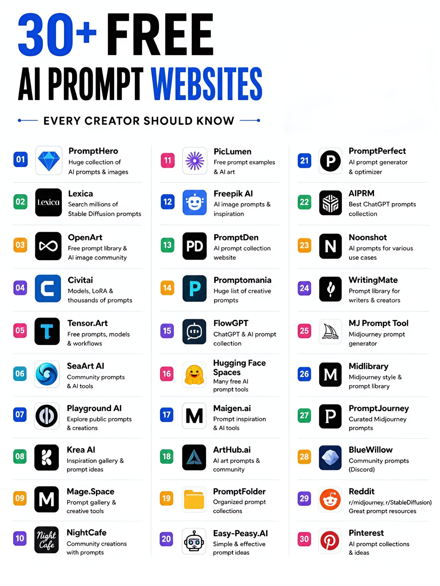
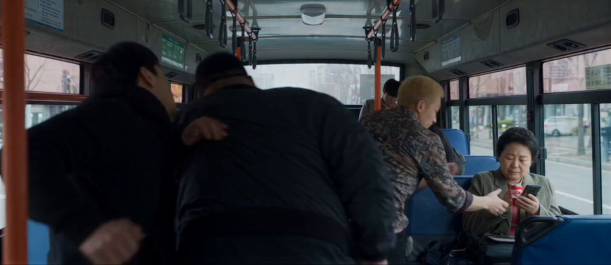

# AI Prompt Radar — 2026-10-18

Bugün bulunan yeni prompt sayısı: **4**

## 1. @AiWithSaira

**Puan:** 54.37 &nbsp; **Etkileşim:** ❤ 775 · 🔁 39 · 👁 242946

**Tam prompt:**

~~~text
This Ai video is absolutely masterpiece 🤯 Generated With Seedance 2.5 Prompt: 👇
~~~

[Kaynak paylaşımı X'te aç ↗](https://x.com/AiWithSaira/status/2110631922959585659)

---

## 2. @AiwithLariab

**Puan:** 50.78 &nbsp; **Etkileşim:** ❤ 318 · 🔁 28 · 👁 58839

**Tam prompt:**

~~~text
This AI video is absolutely amazing 🔥 Seedance 2.5 Prompt: ⤵️
~~~

[Kaynak paylaşımı X'te aç ↗](https://x.com/AiwithLariab/status/2110575089184067910)

---

## 3. @triptitips

**Puan:** 49.91 &nbsp; **Etkileşim:** ❤ 65 · 🔁 24 · 👁 1480

**Tam prompt:**

~~~text
✴️𝟯𝟬+ 𝗙𝗥𝗘𝗘 𝗔𝗜 𝗣𝗥𝗢𝗠𝗣𝗧 𝗪𝗘𝗕𝗦𝗜𝗧𝗘𝗦 The right prompt can completely change your AI output. Here are 30+ free websites to find inspiration and level up your prompts. ✅𝗘𝗩𝗘𝗥𝗬 𝗖𝗥𝗘𝗔𝗧𝗢𝗥 𝗦𝗛𝗢𝗨𝗟𝗗 𝗞𝗡𝗢𝗪 01. 𝗣𝗿𝗼𝗺𝗽𝘁𝗛𝗲𝗿𝗼 → Huge collection of AI prompts & images 02. 𝗟𝗲𝘅𝗶𝗰𝗮 → Search millions of Stable Diffusion prompts 03. 𝗢𝗽𝗲𝗻𝗔𝗿𝘁 → Free prompt library & AI image community 04. 𝗖𝗶𝘃𝗶𝘁𝗮𝗶 → Models, LoRA & thousands of prompts 05. 𝗧𝗲𝗻𝘀𝗼𝗿.𝗔𝗿𝘁 → Free prompts, models & workflows 06. 𝗦𝗲𝗮𝗔𝗿𝘁 𝗔𝗜 → Community prompts & AI tools 07. 𝗣𝗹𝗮𝘆𝗴𝗿𝗼𝘂𝗻𝗱 𝗔𝗜 → Explore public prompts & creations 08. 𝗞𝗿𝗲𝗮 𝗔𝗜 → Inspiration gallery & prompt ideas 09. 𝗠𝗮𝗴𝗲.𝗦𝗽𝗮𝗰𝗲 → Prompt gallery & creative tools 10. 𝗡𝗶𝗴𝗵𝘁𝗖𝗮𝗳𝗲 → Community creations with prompts 11. 𝗣𝗶𝗰𝗟𝘂𝗺𝗲𝗻 → Free prompt examples & AI art 12. 𝗙𝗿𝗲𝗲𝗽𝗶𝗸 𝗔𝗜 → AI image prompts & inspiration 13. 𝗣𝗿𝗼𝗺𝗽𝘁𝗗𝗲𝗻 → AI prompt collection website 14. 𝗣𝗿𝗼𝗺𝗽𝘁𝗼𝗺𝗮𝗻𝗶𝗮 → Huge list of creative prompts 15. 𝗙𝗹𝗼𝘄𝗚𝗣𝗧 → ChatGPT & AI prompt collection 16. 𝗛𝘂𝗴𝗴𝗶𝗻𝗴 𝗙𝗮𝗰𝗲 𝗦𝗽𝗮𝗰𝗲𝘀 → Many free AI prompt tools 17. 𝗠𝗮𝗶𝗴𝗲𝗻.𝗮𝗶 → Prompt inspiration & AI tools 18. 𝗔𝗿𝘁𝗛𝘂𝗯.𝗮𝗶 → AI art prompts & community 19. 𝗣𝗿𝗼𝗺𝗽𝘁𝗙𝗼𝗹𝗱𝗲𝗿 → Organized prompt collections 20. 𝗘𝗮𝘀𝘆-𝗣𝗲𝗮𝘀𝘆.𝗔𝗜 → Simple & effective prompt ideas 21. 𝗣𝗿𝗼𝗺𝗽𝘁𝗣𝗲𝗿𝗳𝗲𝗰𝘁 → AI prompt generator & optimizer 22. 𝗔𝗜𝗣𝗥𝗠 → Best ChatGPT prompts collection 23. 𝗡𝗼𝗼𝗻𝘀𝗵𝗼𝘁 → AI prompts for various use cases 24. 𝗪𝗿𝗶𝘁𝗶𝗻𝗴𝗠𝗮𝘁𝗲 → Prompt library for writers & creators 25. 𝗠𝗝 𝗣𝗿𝗼𝗺𝗽𝘁 𝗧𝗼𝗼𝗹 → Midjourney prompt generator 26. 𝗠𝗶𝗱𝗹𝗶𝗯𝗿𝗮𝗿𝘆 → Midjourney style & prompt library 27. 𝗣𝗿𝗼𝗺𝗽𝘁𝗝𝗼𝘂𝗿𝗻𝗲𝘆 → Curated Midjourney prompts 28. 𝗕𝗹𝘂𝗲𝗪𝗶𝗹𝗹𝗼𝘄 → Community prompts (Discord) 29. 𝗥𝗲𝗱𝗱𝗶𝘁 → r/midjourney, r/StableDiffusion → Great prompt resources 30. 𝗣𝗶𝗻𝘁𝗲𝗿𝗲𝘀𝘁 → AI prompt collections & ideas ❤️ Like 🔁 Retweet 🔖 Bookmark Follow @triptitips for more such posts
~~~

[Kaynak paylaşımı X'te aç ↗](https://x.com/triptitips/status/2105237118654300483)

---

## 4. @ElsaSofia__AI

**Puan:** 42.28 &nbsp; **Etkileşim:** ❤ 122 · 🔁 6 · 👁 2864

**Tam prompt:**

~~~text
This Ai video is absolutely masterpiece 🤯 Generated With Seedance 2.5 Prompt: ⤵️
~~~

[Kaynak paylaşımı X'te aç ↗](https://x.com/ElsaSofia__AI/status/2111413460974330037)

---

_Kaynak içerikler ilgili yazarlara aittir; özgün bağlantılar korunmuştur._
