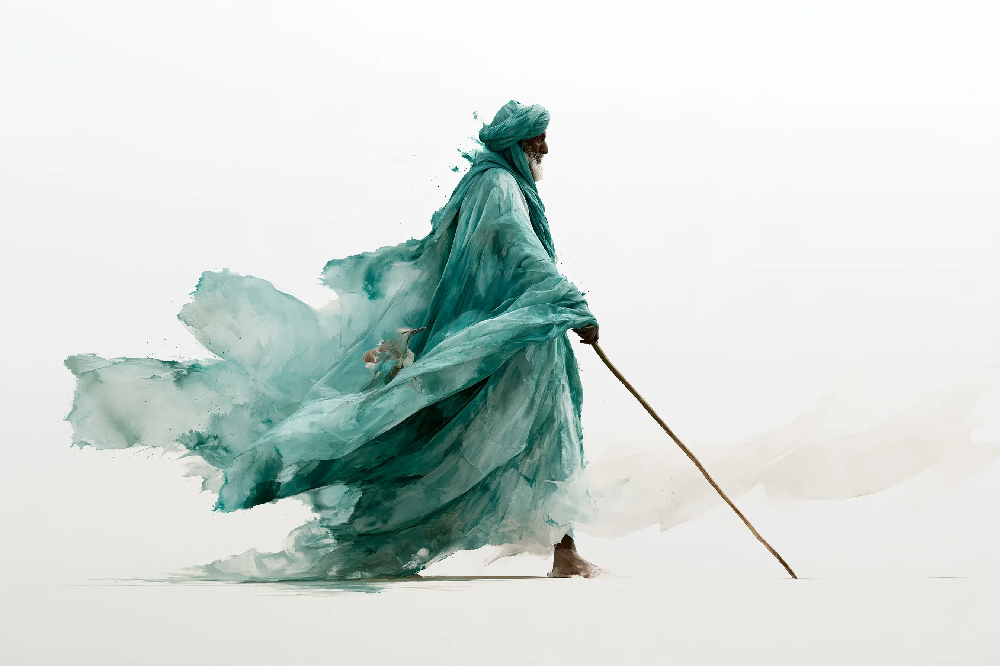
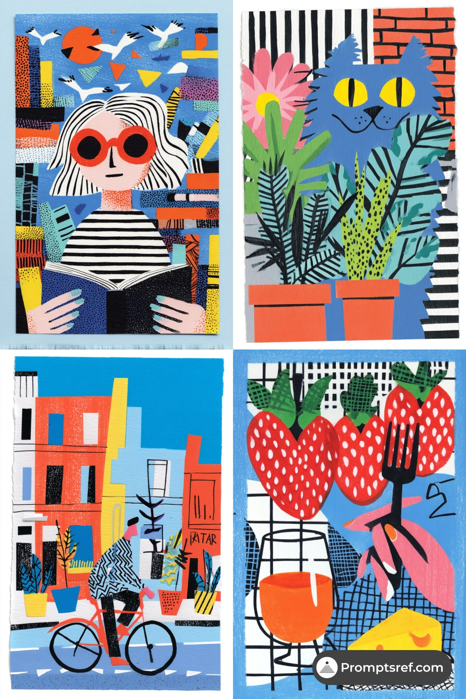

# AI Prompt Radar — 2026-11-03

Bugün bulunan yeni prompt sayısı: **2**

## 1. @azed_ai

**Puan:** 58.99 &nbsp; **Etkileşim:** ❤ 696 · 🔁 67 · 👁 40390

**Tam prompt:**

~~~text
Prompt share: Loose Watercolor Drift 💬 Prompt: Abstract watercolor wash of a [subject], loose oversized brushstrokes, broad flowing color shapes, minimal detail, soft pigment bleeding, expressive wet-on-wet texture, simplified forms, airy composition, no linework, no outlines, white background Try it and share yours ✨
~~~

[Kaynak paylaşımı X'te aç ↗](https://x.com/azed_ai/status/2116848755362484477)

---

## 2. @promptsref

**Puan:** 39.66 &nbsp; **Etkileşim:** ❤ 6 · 🔁 1 · 👁 325

**Tam prompt:**

~~~text
Stop making AI art look too perfect. Try this retro Risograph × Pop Art × Matisse cut-out style: bold color blocks, grainy paper texture, and charming misregistered ink. Full prompt in the comments ↓ --sref 1263660854 #midjourney #sref
~~~

[Kaynak paylaşımı X'te aç ↗](https://x.com/promptsref/status/2117587845787390204)

---

_Kaynak içerikler ilgili yazarlara aittir; özgün bağlantılar korunmuştur._
