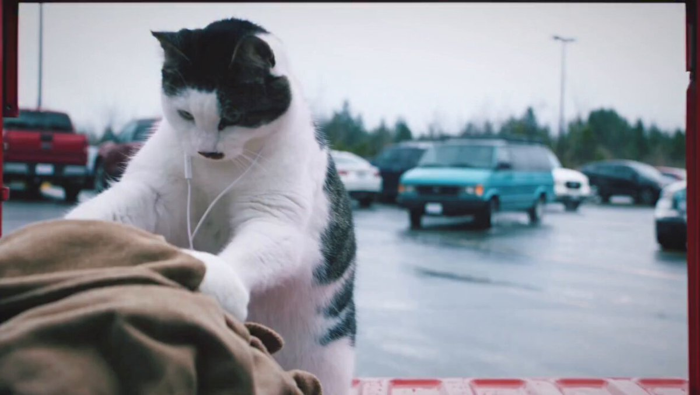

# AI Prompt Radar — 2026-11-05

Bugün bulunan yeni prompt sayısı: **2**

## 1. @ElsaSofia__AI

**Puan:** 43.81 &nbsp; **Etkileşim:** ❤ 117 · 🔁 10 · 👁 5783

**Tam prompt:**

~~~text
Can't believe this video made by AI 🔥 Seedance 2.5 Prompt: ⤵️
~~~

[Kaynak paylaşımı X'te aç ↗](https://x.com/ElsaSofia__AI/status/2110189879682572617)

---

## 2. @openclipsai

**Puan:** 35.74 &nbsp; **Etkileşim:** ❤ 4 · 🔁 0 · 👁 65

**Tam prompt:**

~~~text
GPT-6.1 Terra's prompt: Create a photorealistic, cinematic 10-second video in 16:9 at 720p. 0–3s: A wide tracking shot follows a young woman pedalling a vintage bicycle along a narrow coastal cliff road at sunset. The sea stretches below her as a dark storm rolls in behind her. Strong wind whips her hair and clothes. 3–6s: A low side shot moves alongside the bicycle. Its wheels spin over the rough road as she pedals faster, gripping the handlebars. An old lighthouse appears ahead. 6–10s: The camera follows from behind as she reaches the lighthouse and brakes beside its weathered entrance. At that exact moment, the first lightning bolt strikes in the distance over the sea, briefly lighting the dark clouds. She looks toward the flash. Native sound: rushing wind, distant waves, bicycle wheels rattling over the road, the rhythmic whir of the chain and her breath. A sharp crack of thunder follows the lightning. No music, dialogue, other people, on-screen text, titles or logos.
~~~

[Kaynak paylaşımı X'te aç ↗](https://x.com/openclipsai/status/2116878927041839409)

---

_Kaynak içerikler ilgili yazarlara aittir; özgün bağlantılar korunmuştur._
