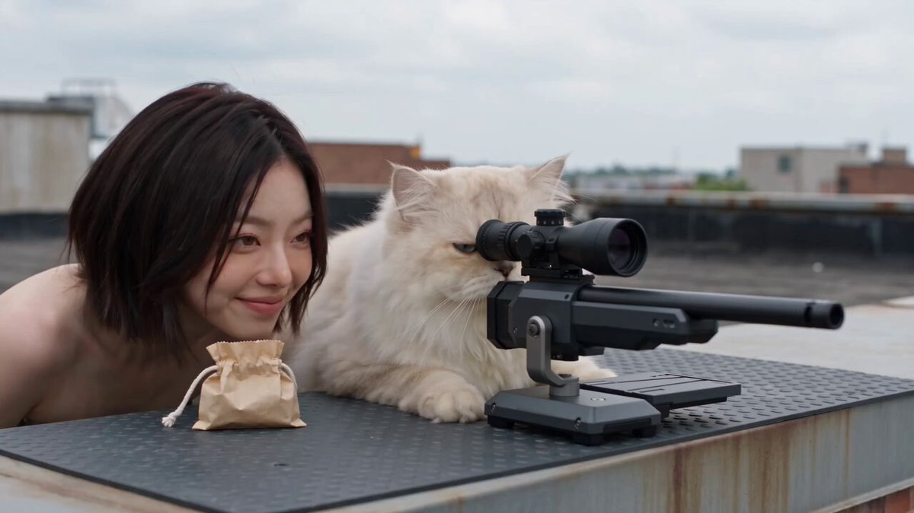
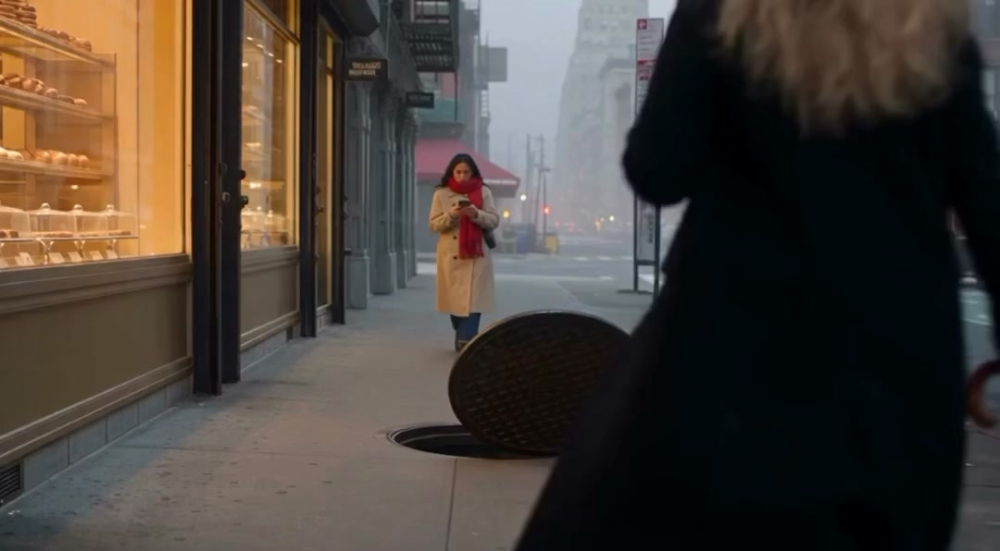
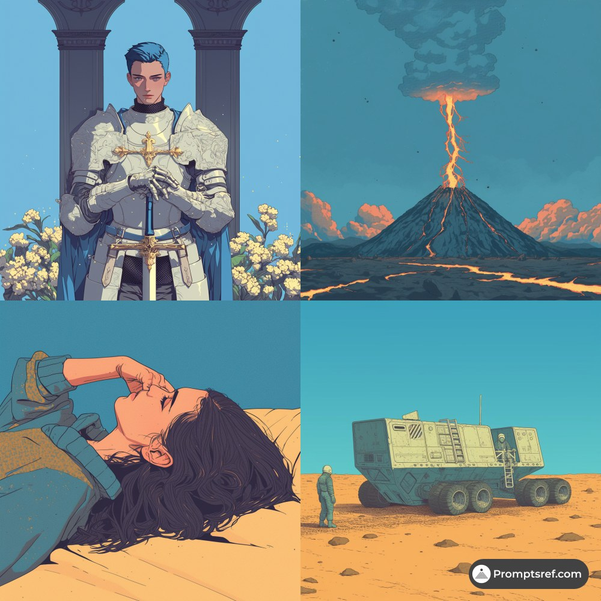

# AI Prompt Radar — 2026-11-08

Bugün bulunan yeni prompt sayısı: **3**

## 1. @ElsaSofia__AI

**Puan:** 65.43 &nbsp; **Etkileşim:** ❤ 2374 · 🔁 192 · 👁 586258

**Tam prompt:**

~~~text
Seedance 2.5 really went all out with this one! 🔥 The AI video looks insanely good. Prompt: ⤵️
~~~

[Kaynak paylaşımı X'te aç ↗](https://x.com/ElsaSofia__AI/status/2111775808784400852)

---

## 2. @ElsaSofia__AI

**Puan:** 47.82 &nbsp; **Etkileşim:** ❤ 148 · 🔁 9 · 👁 13491

**Tam prompt:**

~~~text
This is what the next generation of AI video looks like. Generated with Seedance 2.5 Prompt below:⤵️
~~~

[Kaynak paylaşımı X'te aç ↗](https://x.com/ElsaSofia__AI/status/2119251540334776448)

---

## 3. @promptsref

**Puan:** 42.17 &nbsp; **Etkileşim:** ❤ 10 · 🔁 1 · 👁 632

**Tam prompt:**

~~~text
Try this SREF for neo-retro comic vibes: clean manga lines, teal tones, bold accents, and cinematic mood. Perfect for sci-fi art, indie games, album covers, and posters. Full prompt in the comments ↓ --sref 3897881209 #midjourney #sref
~~~

[Kaynak paylaşımı X'te aç ↗](https://x.com/promptsref/status/2116651655378702635)

---

_Kaynak içerikler ilgili yazarlara aittir; özgün bağlantılar korunmuştur._
