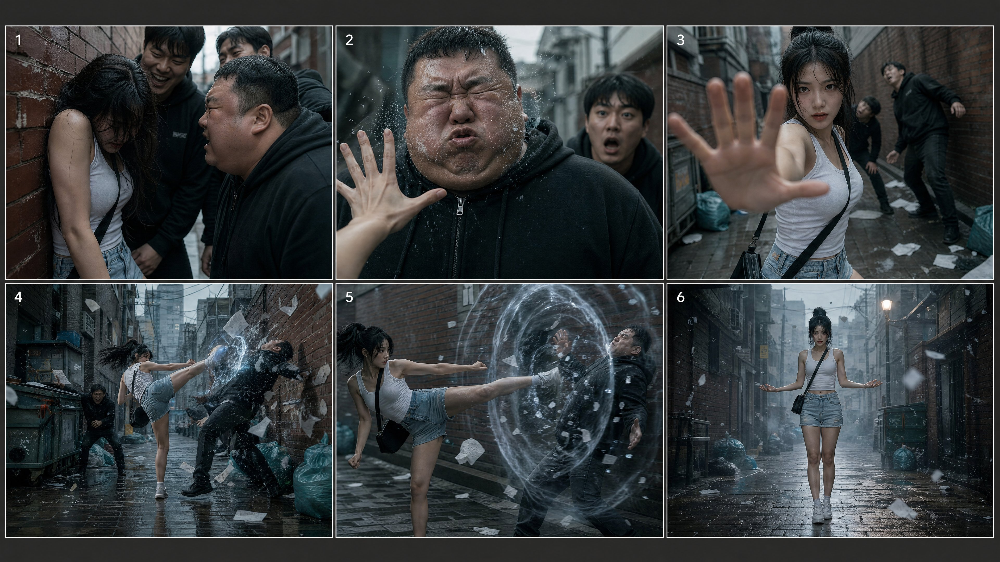
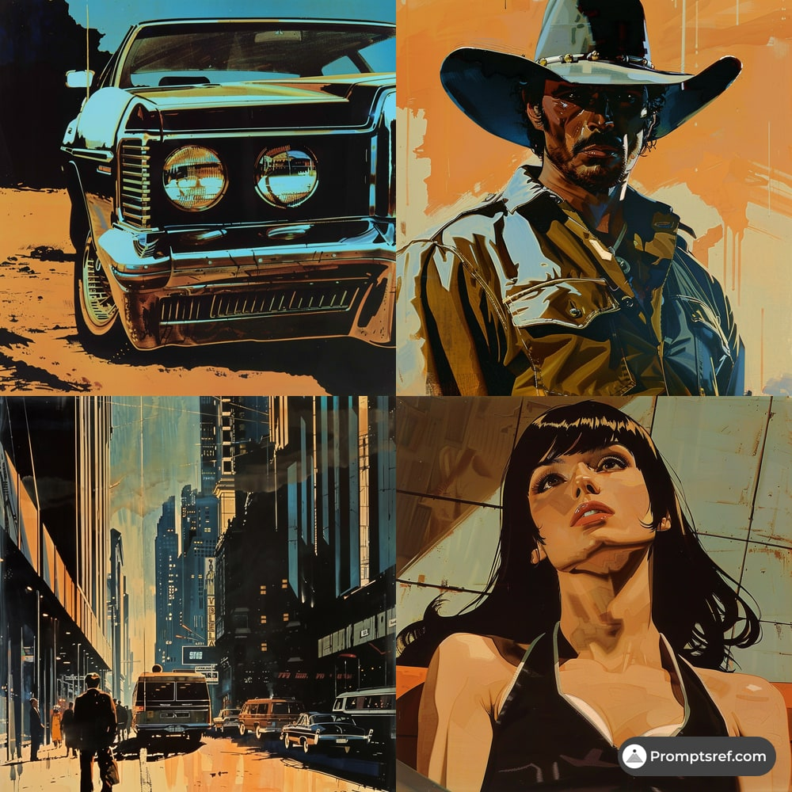
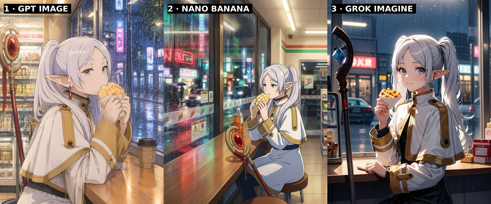
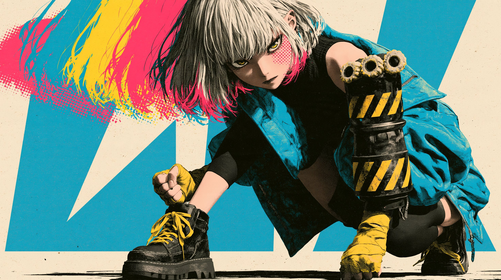

# AI Prompt Radar — 2026-11-11

Bugün bulunan yeni prompt sayısı: **4**

## 1. @AiWithSaira

**Puan:** 48.53 &nbsp; **Etkileşim:** ❤ 16 · 🔁 1 · 👁 3056

**Tam prompt:**

~~~text
Video Prompt: Create a 30-second ultra-realistic Korean urban action short set in a narrow brick alley in Seoul, South Korea, filmed like a gritty live-action thriller. It must feel like a real cinematic fight scene with a supernatural twist, not a cartoon, game or anime. EXACT ORDER — 6 SCENES: 0–6s — CORNERED: The same young Korean woman with long black hair is pinned against a red-brick wall in a narrow alley, head down, hair covering her face, trembling with fear. Four men in dark hoodies crowd in around her, laughing and leaning closer. The biggest man bends toward her with a cruel grin. Tight handheld close-ups. 6–8s — FIRST SHOCKWAVE: She suddenly raises one palm. An invisible force ripples through the air and hits the big man's face in slow motion. His cheeks distort, water droplets burst off his skin, and the other men freeze in shock. 8–12s — AWAKENING: Extreme close-up of her wide eyes, then a low-angle shot as she holds her open palm toward the camera, fear turning into focus. The blurred men stagger in the background. 12–24s — THE FIGHT: Fast, clearly visible fight choreography in the alley. She runs and delivers high kicks and palm strikes, each impact releasing a translucent blue-white energy shockwave. The men are thrown back into dumpsters and walls. Paper and debris explode mid-air, mist sprays, her hair whips with the motion. Every attacker is hit in a clear, readable order. 24–26s — FINAL KICK: A slow-motion side kick sends a glass-like dome shockwave through the last attacker, with floating particles and paper fragments around him. 26–30s — AFTERMATH: Wide, symmetrical shot down the empty alley. She stands calm and composed, palms open, as paper, dust and light mist drift through the air under a glowing street lamp. The attackers are gone, and the alley falls silent. CONTINUITY: Same woman, same four men, same outfits throughout: she wears a white tank top, denim shorts, a small black crossbody bag and white sneakers; the men wear dark hoodies and jeans. Same alley, same dumpsters, teal garbage bags and scattered paper. No identity drift, outfit changes, disappearing props, teleporting or reordered actions. LOCATION: Narrow wet Seoul alley, red-brick walls, grey paving stones with puddles, overhead wires, old shop signs, overcast daylight. Cool teal-grey colour grade. CAMERA: Cinematic handheld, dynamic push-ins, whip pans, tracking shots, speed ramps, shallow depth of field, realistic motion blur, subtle film grain, natural skin texture. No cartoon look, no extra fingers, no face morphing, no text or watermark. SOUND: Heavy bass impact hits, air-pressure booms, whooshes, distant city ambience, light rain. FINAL FEEL: A shocking one-take-style revenge moment where a helpless woman reveals a hidden psychic power, with every scene and action clearly shown in the exact requested order.
~~~

[Kaynak paylaşımı X'te aç ↗](https://x.com/AiWithSaira/status/2110632320399200423)

---

## 2. @promptsref

**Puan:** 44.05 &nbsp; **Etkileşim:** ❤ 18 · 🔁 2 · 👁 621

**Tam prompt:**

~~~text
Neo-retro noir for posters, game art & album covers 🎬 Bold orange/blue contrast, cinematic shadows, and comic-inspired outlines turn any prompt into a story. Try it: Full prompt in the comments. --sref 904529642 #midjourney #sref
~~~

[Kaynak paylaşımı X'te aç ↗](https://x.com/promptsref/status/2118312648542499040)

---

## 3. @JimmyCarsttle

**Puan:** 32.94 &nbsp; **Etkileşim:** ❤ 0 · 🔁 0 · 👁 147

**Tam prompt:**

~~~text
Frieren on a konbini night run. Who nailed her? GPT Image: closest to the anime, melon pan, rainy neon Nano Banana: wide shot, added store logos unasked Grok: twin tails right, melon pan became fried snacks My pick: GPT Image. Which feels like a real episode? Prompt below 👇 Frieren from Frieren: Beyond Journey's End sitting at the window counter of a modern Tokyo convenience store at night, eating a melon pan, silver twin tails, pointed elf ears, white and gold mage cloak, her staff leaning beside her, rain on the glass, neon street outside, warm fluorescent light, official anime key visual style, clean line art, vertical 4:5 composition.
~~~

[Kaynak paylaşımı X'te aç ↗](https://x.com/JimmyCarsttle/status/2118161380956397699)

---

## 4. @Dheepanratnam

**Puan:** 29.74 &nbsp; **Etkileşim:** ❤ 2 · 🔁 0 · 👁 150

**Tam prompt:**

~~~text
Midjourney 8.1 character Start frame image prompt 16:9 anime key frame, Japanese 2D hand drawn battle anime crossed with risograph screenprint poster art. Young woman fighter: chin length bleached bob, blunt bangs, fluorescent pink tips, fierce narrow eyes, pink halftone dot patch on right cheek. Oversized cobalt blue bomber jacket worn open off one shoulder, black high neck top, black shorts over tights, chunky black boots with yellow laces. Left fist wrapped in yellow tape; right forearm in heavy black steel gauntlet with yellow hazard stripes and three rubber roller rings on knuckles. Low coiled crouch right of centre, gauntlet drawn back, left hand forward. Three colour separated afterimages fluorescent pink, cobalt blue, lemon yellow streak left, offset like misprinted poster, edges dissolving into halftone dots. Setting: cream textured paper, low horizon, three giant flat cobalt blue geometric pillars, vast negative space. Four ink colours: fluorescent pink, cobalt blue, lemon yellow, black; overprints create purple, orange, green. Visible halftone shading, misregistration, grainy riso ink, bold anime line art, cel shading. No text, no logo, no 3D.
~~~

[Kaynak paylaşımı X'te aç ↗](https://x.com/Dheepanratnam/status/2119717005599113659)

---

_Kaynak içerikler ilgili yazarlara aittir; özgün bağlantılar korunmuştur._
