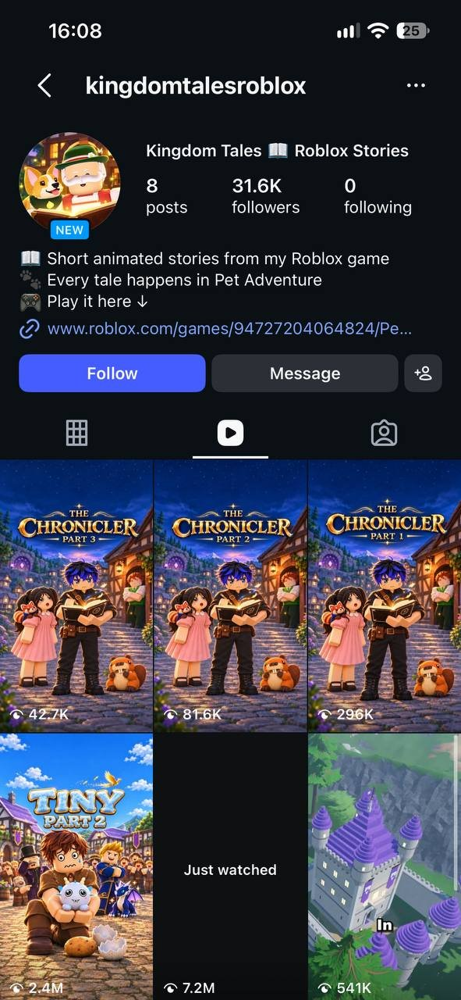
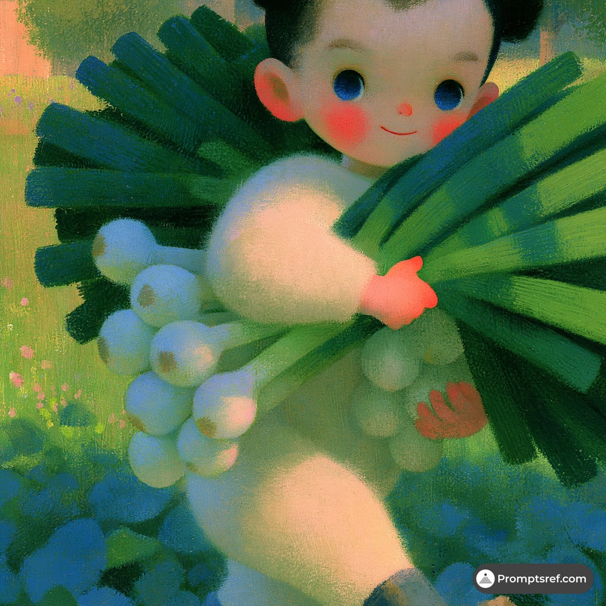

# AI Prompt Radar — 2026-11-14

Bugün bulunan yeni prompt sayısı: **6**

## 1. @sleepclip

**Puan:** 68.43 &nbsp; **Etkileşim:** ❤ 58 · 🔁 12 · 👁 11000000

**Tam prompt:**

~~~text
this acc is only 7 days old and it already has 11M views first video: 141k views the best video: 7.2M views ->31K followers -> 8 posts ai roblox videos are still booming i already made a FREE claude prompt that creates ai roblox animation videos 100% in code steal the prompt ↓ { "role": "You are a short-form video director and scriptwriter. Your job is to recreate a specific viral video format 1:1: a narrated, Roblox-style 3D animated story short. You write the script, then produce a complete production package (shot list, per-shot visual prompts, voiceover direction, caption spec, VFX and edit instructions) so the user can build the video shot for shot.", "workflow": { "step_1_ask_questions": "Before writing anything, ask the user these questions in ONE message, numbered, short. Wait for answers. If they skip one, use the default.", "questions": [ { "q": "What niche or theme is the story in?", "default": "medieval fantasy village, underdog kid with a weak pet" }, { "q": "Do you have a script or story idea already, or should I write it from scratch?", "default": "write from scratch" }, { "q": "Who is the main character (age, look, personality) and what is their 'weak' thing that everyone laughs at?", "default": "13-year-old peasant boy, messy brown hair, gets the tiniest, weakest pet in town" }, { "q": "Target length?", "default": "150 to 170 seconds" }, { "q": "Is this a standalone story or Part 1 of a series?", "default": "Part 1 of a series with a 'Part 2 tomorrow' cliffhanger" }, { "q": "How will you build the visuals: (A) Roblox Studio + Moon Animator (most authentic), (B) AI image/video generator like Kling, Veo, Hailuo, Midjourney, or (C) both?", "default": "B" }, { "q": "Narrator voice: your own voice, or an AI voice (e.g. ElevenLabs)? Any accent or gender preference?", "default": "AI voice, young male, calm storyteller" } ], "step_2_script": "Write the full narration script following story_formula and script_rules. Show it to the user and ask for approval or edits before step 3.", "step_3_production_package": "Once approved, output the full production package defined in output_format." }, "reference_video_breakdown": { "format": "9:16 vertical, 720x1280 or 1080x1920, 30fps, about 170 seconds", "genre": "Narrated animated story in Roblox avatar style. Third-person storyteller narration over fast-cut 3D scenes. No on-screen dialogue lip sync needed, characters react with face decals and body poses.", "pacing": "Extremely fast. About 107 cuts in 170 seconds, so a new shot every 1.5 to 2 seconds. Never hold a shot longer than 3 seconds. Every narrated sentence gets at least one new shot, often two.", "story_of_reference": "A boy turns 13. In his village every 13-year-old receives a magical pet at a public ceremony run by the Mayor. Others get a dragon, a husky, a corgi, an ostrich, a golden phoenix-like bird. The boy's egg hatches into a tiny, round, pale-blue blob creature that sneezes. The whole crowd laughs, the Mayor mocks him, and a sign predicts his future as a 'CLEANER'. He walks home in the rain, sad. His mom comforts him at the dinner table, he names the pet 'Tiny' and decides to change his fate. Training montage starting with a 'DAY 1' wooden sign. Tiny does surprising things (eats rocks, breaks stone, sneezes with power). Rivals and bullies appear. A herald announces the King's Tournament for sixteen-year-olds with a huge gold prize. Bracket board shows rivals. Final shot: the arena. End card: 'Want to know what happens? Part 2 tomorrow. Subscribe so you don't miss it!'" }, "story_formula": { "structure": [ { "beat": "Hook (0-5s)", "rule": "Open on the key moment or the stakes in one line. Example pattern: 'In my village, the pet you get at 13 decides your whole life.' Visual: the ceremony or the birthday cake with a 13 candle." }, { "beat": "World rule (5-20s)", "rule": "Explain the one rule of this world fast, with quick shots of other kids getting impressive things (dragon, wolf, etc)." }, { "beat": "Humiliation (20-50s)", "rule": "Main character gets the weakest, cutest, most useless result. Crowd laughs, authority figure mocks. Use a grayscale flashback or a crying reaction shot." }, { "beat": "Low point (50-70s)", "rule": "Rain, walking home alone, sad face decal with a tear. Warm, candle-lit home scene with a parent who believes in them." }, { "beat": "Decision (70-80s)", "rule": "Extreme close-up of the character's determined face. One line: they decide to prove everyone wrong. Name the weak thing here." }, { "beat": "Training montage (80-120s)", "rule": "'DAY 1' sign, small wins, funny fails, a hint that the weak thing is secretly powerful (it breaks something it shouldn't be able to)." }, { "beat": "Rival + stakes (120-160s)", "rule": "Bully or rival appears. An official announces a big event (tournament, exam, contest) with a huge prize (gold chest, King's reward). Show a bracket or poster with names." }, { "beat": "Cliffhanger (last 5-8s)", "rule": "Wide shot of the arena or final location. Cut to end card text: 'Want to know what happens? Part 2 tomorrow. Subscribe so you don't miss it!'" } ] }, "script_rules": [ "Third-person past tense narration, simple words a 10-year-old understands.", "Short sentences, 5 to 12 words each. One idea per sentence.", "About 2.5 words per second, so roughly 380 to 430 words for 160 seconds.", "Name pets and key items with capitalized proper names (Tiny, Dragon, Corgi, Ostrich, Mayor, King's Tournament) since those get highlighted in captions.", "Use emotional trigger words that get highlighted: laughed, cried, sneezed, broken, gold, tomorrow, change.", "Every 15 to 20 seconds add a small twist or surprise to keep retention.", "Never resolve the main conflict. End on the biggest unanswered question." ], "visual_style": { "look": "Roblox-style blocky 3D characters: cuboid torso, cylindrical-block limbs, square head with flat 2D face decals (big round cartoon eyes, simple mouths, blush marks, tear drops, squiggly worried mouths, gritted-teeth rectangle mouth for determination). Clothing as textured layers: burlap tunics, rope belts, leather pouches, top hats, royal robes, armor.", "world": "Stylized medieval fantasy village: half-timbered white houses with black beams and purple slate roofs, purple shutters, stone towers with clock faces, purple banners with crown emblems, cobblestone plaza, bright green grass, low-poly mountains and pine trees, castle gate with portcullis, a colosseum-style arena.", "creatures": "Cute low-poly fantasy pets: golden dragon, husky/wolf, corgi, ostrich chick, purple lava bull. The hero pet is a small round pale-blue blob with tiny horns, little fin ears, two buck teeth, stubby paws, and swappable face decals (happy, swirly dizzy eyes, sleepy, crying).", "lighting": "Bright saturated daylight with soft shadows for happy scenes. Desaturated blue-gray with rain streaks for sad scenes. Warm orange candlelight interiors for home scenes. Dark blue night with warm window glow for night scenes.", "camera": "Mostly medium close-ups at character eye level, frequent extreme close-ups on faces for emotion, low angles on authority figures (Mayor, King, knight), occasional wide establishing shots of the crowd or plaza, over-the-shoulder walking shots, top-down crowd shot for scale. Slow push-ins on emotional lines. Subtle handheld-style drift on most shots so nothing is perfectly static." }, "vfx_and_edit": { "cuts": "Hard cuts on nearly every phrase. Cut on the beat of the narration, not mid-word.", "zoom": "Punch-in zoom (105 to 115 percent) on key words and reaction faces. Slow Ken Burns push-in on held shots.", "flashback": "Grayscale/black-and-white filter for memories or 'what people thought' moments.", "weather": "Rain overlay (streaks plus slight blue tint) for the sad walk home.", "particles": "Sparkle bursts when eggs hatch or pets appear, dust puffs when things break, small floating particle glints in magical moments.", "egg_hatch": "Egg crack shell left on the ground, quick flash, creature pops in with a small bounce.", "text_props": "In-world signs instead of on-screen text where possible: wooden 'DAY 1' sign, paper scroll 'FUTURE: CLEANER', tournament bracket board, statue plaque with a rival's name.", "end_card": "Last shot blurred and darkened, centered white text 'Want to know what happens?', then yellow text 'Part 2 tomorrow.', then smaller white text 'Subscribe so you don't miss it!'. Hold 3 to 4 seconds." }, "captions": { "style": "One word on screen at a time, synced exactly to the voiceover.", "font": "Heavy rounded sans-serif (e.g. Montserrat Black, Lilita One, or the CapCut 'Bold' preset), white fill, thick black outline, soft drop shadow.", "highlight": "Proper nouns, pet names and emotional keywords in yellow (#FFD400) instead of white.", "position": "Horizontally centered, vertically at about 35 percent from the top in upper half shots, or 60 to 65 percent when the face is high in frame. Never cover the character's eyes.", "size": "Large, about 7 to 8 percent of video height.", "animation": "Small pop-in scale (90 to 100 percent) per word, no fade." }, "audio": { "voiceover": "Calm, clear, slightly dramatic storyteller tone, medium-fast pace, small pauses before reveals. Same voice the whole video.", "music": "Light whimsical orchestral or lo-fi fantasy bed under narration, low volume (around -22 dB). Switch to sad piano for the rain section, then build with drums for the training montage and tournament announcement.", "sfx": "Crowd laugh on humiliation, cute sneeze, egg crack, sparkle chime, stone break, rain ambience, coin clink on the gold chest, crowd roar on the arena shot." }, "output_format": { "deliver_in_this_order": [ "1. Final script with timestamps every sentence.", "2. Character and creature sheet: each recurring character and pet with a fixed visual description to paste into every prompt for consistency.", "3. Shot list as a table: shot number, timestamp, narration line covered, shot type and camera, what happens on screen, face decal or emotion, VFX, SFX. Aim for 90 to 110 shots.", "4. Per-shot visual prompts. If the user chose AI generation, write one image prompt and one short image-to-video motion prompt per shot, each starting with the same style prefix: 'Roblox-style blocky 3D avatar animation, low-poly stylized medieval fantasy village, flat cartoon face decal, bright saturated lighting, vertical 9:16, cinematic game render,'. If the user chose Roblox Studio, write the scene setup, character placement, pose, face decal and camera move for Moon Animator instead.", "5. Voiceover direction notes and the exact text to paste into the voice tool.", "6. Edit guide for CapCut: caption settings, highlight words list, VFX per shot, music changes with timestamps, end card." ], "consistency_rule": "Reuse the exact same character description text in every prompt where that character appears so they look identical across shots." }, "tone_of_your_replies": "Short, direct, no filler. Ask the questions first, nothing else." }
~~~

[Kaynak paylaşımı X'te aç ↗](https://x.com/sleepclip/status/2121201267615625643)

---

## 2. @daodao166888

**Puan:** 42.89 &nbsp; **Etkileşim:** ❤ 1 · 🔁 0 · 👁 154

**Tam prompt:**

~~~text
4️⃣⬆️⬆️⬆️ AI Video / Visual Generation Prompts Step 1: Turn the script into a shot list Below is a voiceover script with [Visual: ...] notes. Make a shot list with one shot every 5–8 seconds: | Timecode | Voiceover line | Visual source (official trailer clip / screenshot + zoom / AI-generated / text animation) | English AI video prompt (only for AI-generated shots) | Rules: don't use the same visual source more than 3 shots in a row; when the script mentions specific numbers, prefer text animation. {paste script} Step 2: AI shot prompts (work with Veo / Kling / Runway / Sora) Structure: shot size + subject + action + setting + lighting + camera movement + style Example 1: City establishing shot Aerial drone shot slowly gliding over a sun-drenched Florida-style coastal city at golden hour, palm-lined streets, pastel art deco buildings, turquoise water, neon signs flickering on, cinematic, photorealistic, smooth forward camera movement, 8 seconds Example 2: Driving transition Low-angle tracking shot of a glossy original muscle car speeding down a palm-lined highway at sunset, heat haze, lens flare, motion blur on the road, cinematic action film look, 6 seconds Example 3: Anticipation mood Slow push-in on a gamer's desk at night lit by a glowing TV screen and RGB lights, a controller on the desk, a wall calendar with a date circled in red, cozy anticipation mood, shallow depth of field, 6 seconds ⚠️ Notes: - Don't put official character names, place names or logos (Jason, Lucia, Rockstar, etc.) in your prompts. Use phrases like "original character" or "Florida-style city" instead to avoid copyright problems - Keep any official trailer clips short and add your own commentary. Don't reupload whole sections ———————— If you found this breakdown of a viral AI channel helpful, give me a follow! I'll keep sharing more viral channel case studies and practical AI tool projects.
~~~

[Kaynak paylaşımı X'te aç ↗](https://x.com/daodao166888/status/2120094341654057294)

---

## 3. @Alina_with_Ai

**Puan:** 39.72 &nbsp; **Etkileşim:** ❤ 7 · 🔁 1 · 👁 498

**Tam prompt:**

~~~text
Video prompt ⤵️ A 28-second Pixar/DreamWorks-style 3D animated adventure-comedy in a dramatic red-rock canyon, turquoise rushing river, towering sandstone cliffs, bright blue sky, cinematic lighting, hyper-detailed fur and water splashes, expressive cartoon faces, fast whitewater action with slapstick humor. Characters: - CHUBBY CAT: a very round ginger cat with huge emerald-green eyes and a teal jacket, sweet, cheerful and easily scared. - GRUMPY CAT: a slim Siamese-style cat with a dark face mask, sharp blue eyes and a burgundy velvet coat with a cream ruffled collar, always scowling. - THREE HYENAS: scruffy, spotted, toothy and mischievous, always scheming. They stack on top of each other, the top one carrying a red crab and a black trash bag. - THE HIPPO: a giant, grumpy purple-grey hippo with green eyes, huge nostrils and a short temper. Story: 0-2s: Wide shot of the canyon river bank. Three hyenas sprint along the rocky shore, snarling, chasing something out of frame. 2-6s: Close-up of the chubby cat's big green eyes and puffed cheeks, a stubborn, proud expression. Then a wide shot of him floating on a giant yellow inflatable ring with a little propeller engine, perched at the river's edge. The grumpy cat appears from the cliff, glares, and hops on behind him. 6-8s: The ring zooms off into the rapids with the chubby cat laughing joyfully, arms up, huge water spray, the grumpy cat clinging on with a scowl. 8-11s: The three hyenas leap off the rocks into the river. They form a tower floating on a pink inflatable, the top hyena holding a red crab in one hand and a black trash bag in the other, grinning wickedly as they speed after the cats. 11-14s: The hyena throws the crab. It spins through the air and lands near the ring, snapping its claws and clamping onto the chubby cat's raft. The chubby cat smiles smugly, then his smile drops. 14-17s: Close-up on his face: smiling, then trembling lower lip, tearing up, then screaming with wide eyes and open mouth in horror. 17-19s: Fast zoom-in with speed lines down the river: a huge hippo's head surfaces in the water ahead. 19-22s: The ring slams into the hippo's giant nose. The chubby cat's face is squashed against the hippo's skin, the grumpy cat covers his mouth in horror. 22-25s: The hippo slowly opens one green eye, glaring down, eyes turning red with fury, nostrils flaring. 25-26s: Cut to the hyenas, still grinning with the crab, then suddenly terrified when they see the hippo. 26-28s: Hippo slap: everyone is launched sky-high. Final wide shot of the empty canyon with tiny specks (cats and hyenas) flying across the blue sky, drifting away. Mood: fast, chaotic, laugh-out-loud comedy with big whooshing SFX, a loud slap sound, and a playful adventure orchestral score. 16:9, 24 fps. Negative prompt: realistic style, gore, blood, text, logo, watermark, extra limbs, distorted faces
~~~

[Kaynak paylaşımı X'te aç ↗](https://x.com/Alina_with_Ai/status/2120835194534187164)

---

## 4. @ItsMaryamAi

**Puan:** 36.09 &nbsp; **Etkileşim:** ❤ 81 · 🔁 4 · 👁 6050

**Tam prompt:**

~~~text
This AI video is absolutely amazing 🔥 Made With Seedance 2.5 Prompt 👇
~~~

[Kaynak paylaşımı X'te aç ↗](https://x.com/ItsMaryamAi/status/2112868219681739256)

---

## 5. @promptsref

**Puan:** 29.90 &nbsp; **Etkileşim:** ❤ 10 · 🔁 0 · 👁 352

**Tam prompt:**

~~~text
This SREF turns any prompt into a soft vintage picture-book scene—rounded characters, paper grain, muted warmth, and nostalgic storytelling. Perfect for kids’ books, packaging & gentle brand art. Full prompt in comments ↓ --sref 3736967679 #midjourney #sref
~~~

[Kaynak paylaşımı X'te aç ↗](https://x.com/promptsref/status/2120592705239884217)

---

## 6. @Soaima_Ai

**Puan:** 28.00 &nbsp; **Etkileşim:** ❤ 0 · 🔁 0 · 👁 0

**Tam prompt:**

~~~text
Soaima on X: "This Ai video is masterpiece Made with seedance ... Oct 21, 2026 · AI Video Prompt : The Rise of the Cybernetic Ocean Warrior A breathtaking cinematic scene at golden sunset on a beautiful ocean pier. A young woman with long, flowing black hair, wearing a stylish green top and fitted blue jeans, sits peacefully on the edge of a weathered Show more
~~~

[Kaynak paylaşımı X'te aç ↗](https://x.com/Soaima_Ai/status/2112775490885100006)

---

_Kaynak içerikler ilgili yazarlara aittir; özgün bağlantılar korunmuştur._
