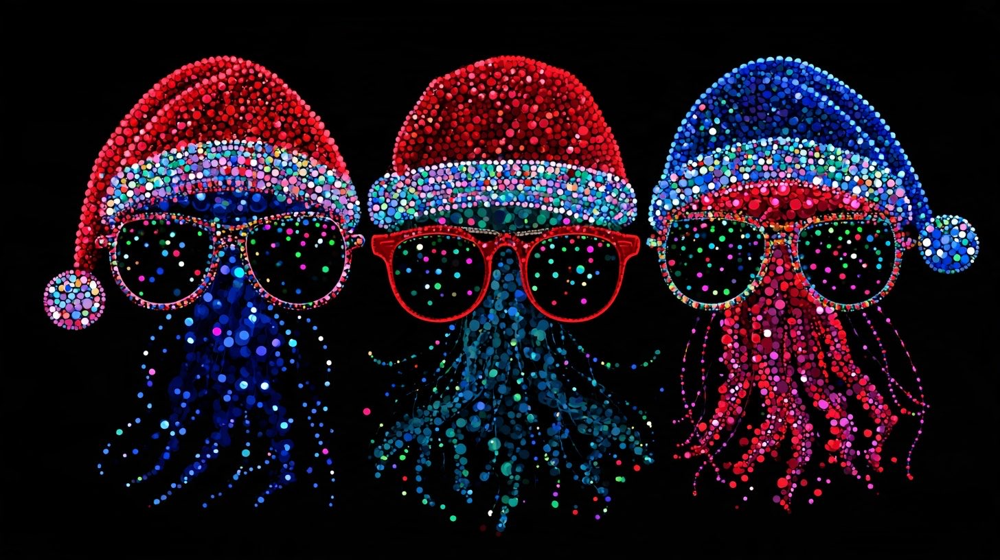
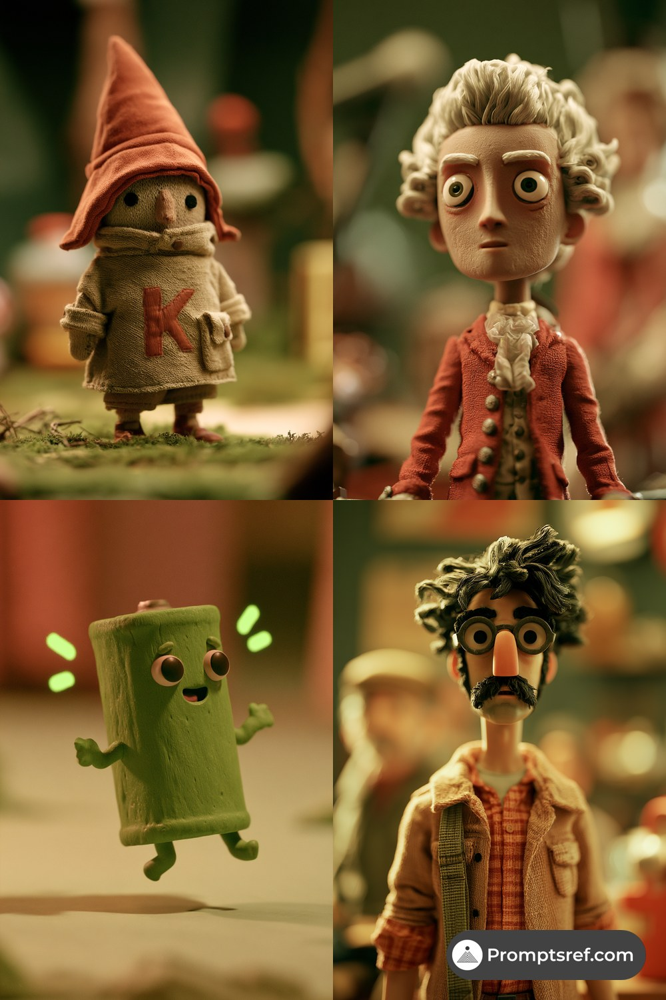

# AI Prompt Radar — 2026-11-23

Bugün bulunan yeni prompt sayısı: **3**

## 1. @Shinebynous

**Puan:** 51.36 &nbsp; **Etkileşim:** ❤ 10 · 🔁 2 · 👁 350

**Tam prompt:**

~~~text
Only 5 words made this image Prompt: Spectacles festive jellyfish dot-art caricature 1. Made with @midjourney 8.2 2. Made with @Kling_ai 4 3. Made with @krea_ai 3 4. Made with @magnific one 5. Made with @ideogram_ai 4.5 6. Made with @dreamina_ai Seedream 5.5 7. Made with @ChatGPT 2.6 8. Made with @recraftai 4.1 9. Made with Microsoft MIA 10.Made with @BlueberryFunded Flux 3 11. Made with @Google Nano Banana 2.1 12. Made with @Alibaba_Qwen Qwen 3.0 pro
~~~

[Kaynak paylaşımı X'te aç ↗](https://x.com/Shinebynous/status/2123418518762717435)

---

## 2. @HolyGrail__69

**Puan:** 37.11 &nbsp; **Etkileşim:** ❤ 0 · 🔁 0 · 👁 112

**Tam prompt:**

~~~text
🎬 AI VIDEO PROMPT Create a photorealistic vertical 9:16 video, 1080x1920, 30 FPS, duration 9.85 seconds. SCENE: A sunny tropical city street with palm trees, parked cars and a modern light-colored building. A bright lime-green luxury sports coupe is parked beside the sidewalk. Its side door is open, revealing a black interior with green details. CHARACTER: One adult woman with light skin and long straight brown hair, center-parted. She wears a pale-pink sleeveless fitted mini dress with a collared neckline, bright-pink piping and a flared skirt. White low-top sneakers, delicate rings and wrist jewelry. POSITION: Woman stands beside the open car door, slightly right of center. Car fills the left side of the frame. ACTION TIMELINE: 0:00–0:03 She straightens up beside the open door and looks briefly toward the camera. 0:03–0:06 She lifts one leg, balances naturally and reaches down to adjust her white sneaker. 0:06–0:09.85 She lowers her foot, stands upright, smooths her dress and brushes her hair back with one hand. She finishes with a natural expression toward the camera. CAMERA: Vertical smartphone video, eye-level medium full shot. One continuous take. Mostly static camera with subtle natural handheld movement. Keep the entire character and open car door visible. VISUAL STYLE: Photorealistic, bright natural daylight, realistic skin texture, natural shadows, detailed fabric, realistic car reflections. CONSISTENCY: Maintain identical facial features, hairstyle, body proportions, dress, sneakers, car color and environment throughout the entire video. NEGATIVE: Face morphing, identity drift, extra limbs, distorted hands, broken fingers, unnatural leg bending, floating feet, changing clothes, disappearing car door, vehicle deformation, flickering reflections, background changes, duplicated objects, watermarks, logos, random text.
~~~

[Kaynak paylaşımı X'te aç ↗](https://x.com/HolyGrail__69/status/2124271755749445704)

---

## 3. @promptsref

**Puan:** 36.47 &nbsp; **Etkileşim:** ❤ 7 · 🔁 2 · 👁 371

**Tam prompt:**

~~~text
What if your idea became a handmade stop-motion fairy tale? 🧵✨ Perfect for storybooks, cozy brands, characters & miniature worlds. Try it: Full prompt in the comments 👇 --sref 2523572232 #midjourney #sref
~~~

[Kaynak paylaşımı X'te aç ↗](https://x.com/promptsref/status/2123537014460928325)

---

_Kaynak içerikler ilgili yazarlara aittir; özgün bağlantılar korunmuştur._
