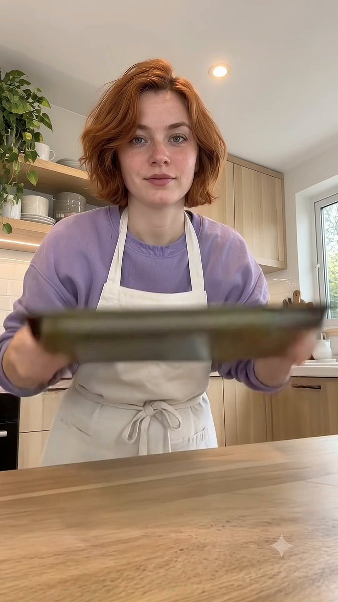
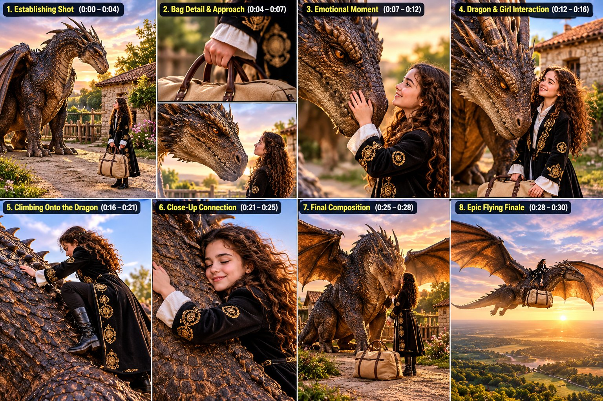

# AI Prompt Radar — 2026-11-27

Bugün bulunan yeni prompt sayısı: **2**

## 1. @ViralOps_

**Puan:** 47.97 &nbsp; **Etkileşim:** ❤ 221 · 🔁 24 · 👁 11975

**Tam prompt:**

~~~text
BOOKMARK THIS IMMEDIATELY. now you can literally create videos like this without spending a SINGLE dollar. here's the entire workflow: open gemini and explain the kind of video you want to create. ask it to write an image prompt for your character, then generate the image using that prompt. now ask gemini to turn your video idea into a 15s video prompt. if you want a 30s or 60s video, simply ask it to break the idea into multiple 10, 15s etc prompts. then open google flow and choose omni flash 1.2. upload your character image and any other reference images you want to use. select 10s or 15s, paste your video prompt and then hit generate. once it's ready, you'll have a ridiculously realistic ai video that costs you NOTHING. below is the full tutorial on how you can generate unlimited AI videos for absolutly FREE. i've attached the exact image and prompt behind this video so you can test it yourself. imagine how much content you could create with this workflow. everything you need to know is in the article below:
~~~

[Kaynak paylaşımı X'te aç ↗](https://x.com/ViralOps_/status/2125403345288593704)

---

## 2. @ZunairaSaeedAi

**Puan:** 45.43 &nbsp; **Etkileşim:** ❤ 3 · 🔁 0 · 👁 514

**Tam prompt:**

~~~text
MASTER VIDEO PROMPT — A GIRL AND HER LOYAL DRAGON FRIEND Create a 30-second ultra-realistic, cinematic fantasy adventure video that closely follows the described scene progression, character interactions, camera movements, and emotional storytelling. VISUAL STYLE: Photorealistic cinematic fantasy, highly detailed 3D creatures, realistic human expressions, natural body movements, realistic dragon anatomy, warm golden-hour lighting, shallow depth of field, cinematic color grading, detailed textures, atmospheric countryside environment, 4K quality, 16:9 widescreen. CHARACTER LOCK — GIRL: A young woman with long, thick, naturally curly dark-brown hair, delicate facial features, expressive brown eyes, and a gentle personality. She wears a long black medieval fantasy coat with elegant golden embroidered circular patterns, gold buttons, wide white cuffs, a white inner blouse, dark trousers, and black leather boots. Her clothing, hairstyle, face, and proportions must remain identical throughout every shot. CHARACTER LOCK — DRAGON: One enormous, friendly, highly detailed fantasy dragon. Its body has rough dark-brown and bronze-colored scales, a long muscular neck, a large reptilian head, multiple curved horns, expressive amber-golden eyes, powerful legs, enormous leathery wings, and a long spiked tail. The dragon must look majestic and powerful but gentle, protective, and affectionate toward the girl. Maintain identical anatomy, horns, scales, eye color, and body proportions throughout the video. ENVIRONMENT: A peaceful medieval countryside at sunset. A rustic stone farmhouse with a tiled roof, a wooden entrance, a dirt courtyard, surrounding green bushes, distant countryside fields, and a warm golden sky. A large beige canvas travel duffel bag with dark-brown leather handles and straps rests beside the girl. SCENE-BY-SCENE ACTION AND CAMERA DIRECTIONS SCENE 1 — 0:00–0:04 | Establishing Wide Shot Open with a cinematic wide establishing shot of the countryside farmhouse during golden hour. The giant dragon stands on the left side of the frame, facing the young woman. The girl stands on the right, slightly leaning forward while holding the handle of her large beige travel bag. The dragon slowly lowers its enormous head toward her. Its wings remain folded naturally against its body. The girl looks downward toward her bag and then toward her dragon friend. Camera: Wide cinematic composition, slightly low camera angle, slow and subtle forward dolly movement. Keep both characters fully visible. SCENE 2 — 0:04–0:07 | Bag Detail and Dragon Approach Cut to a close-up of the girl's hand firmly holding the dark-brown leather handles of the beige canvas travel bag. Show realistic finger movement, fabric creases, leather texture, and the movement of her black embroidered sleeve and white cuff. Transition into a medium shot as the dragon gently brings its large head closer to the girl and the bag. Camera: Close-up detail shot followed by a smooth cinematic cut to a medium side angle. SCENE 3 — 0:07–0:12 | Emotional Friendship Moment The dragon gently lowers its head beside the girl. Its amber eyes look toward her with a calm, affectionate expression. The girl slowly raises her right hand and gently touches the dragon's rough, scaled face. She softly strokes its cheek and snout. The dragon responds by lowering its head further and relaxing its posture. The girl smiles naturally, showing genuine affection. Camera: Intimate medium close-up, alternating between the girl's facial expression and the dragon's eye and face. Use a subtle camera push-in. Maintain realistic eye contact and natural hand contact. SCENE 4 — 0:12–0:16 | Dragon and Girl Interaction Show the dragon gently moving its enormous head downward and turning slightly toward the travel bag. The girl stands beside it, smiling softly. The dragon carefully positions its head and neck close to her, communicating trust and friendship without aggression. Camera: Three-quarter side angle, medium shot, followed by a close-up of their faces. Use smooth, controlled cinematic camera movement. SCENE 5 — 0:16–0:21 | Climbing Onto the Dragon Transition to a side-angle shot showing the girl's position beside the dragon's enormous spiked back. She carefully approaches the dragon's back, places both hands against its textured scales, and begins climbing onto it. Her movements must be physically believable. Her hands grip the dragon's back securely, her legs move naturally, and her coat and curly hair respond to gravity and movement. The dragon remains calm and steady, allowing her to climb. Camera: Medium-wide side tracking shot, slightly low angle. Follow her movement smoothly without sudden camera jumps. SCENE 6 — 0:21–0:25 | Close-Up Emotional Connection Show the girl leaning forward and wrapping her arms affectionately around the dragon's thick neck. She rests her cheek against its scales and smiles with her eyes gently closed. The dragon bends its neck slightly toward her, reinforcing their emotional bond. Capture the texture of the dragon's scales, the girl's hands, her curly hair, and the embroidered details of her black coat. Camera: Cinematic close-up from the side, followed by a slightly wider over-the-shoulder composition. Warm sunset light illuminates both characters. SCENE 7 — 0:25–0:28 | Final Countryside Composition Cut to a wider composition in front of the stone farmhouse. The dragon lowers its head toward the girl while she stands beside it. The beige travel bag is clearly visible on the ground in front of them. The dragon's large wings begin to extend naturally, preparing for flight. Camera: Wide side-angle shot, smooth slow pullback, beautiful golden-hour background. SCENE 8 — 0:28–0:30 | Epic Flying Ending Finish with a cinematic aerial wide shot of the enormous dragon flying above the green countryside fields during sunset. Its massive wings perform powerful, realistic flapping movements. Its long tail follows naturally through the air. The dragon carries the travel bag securely, while the girl rides safely on its back. The camera follows them from a slightly behind-and-side aerial perspective as they fly toward the glowing golden horizon. End with a beautiful, majestic fantasy adventure feeling. CAMERA AND MOTION REQUIREMENTS - Use cinematic wide shots to establish the environment. - Use medium shots for interactions between the girl and dragon. - Use close-ups for facial expressions, hands, dragon eyes, and emotional moments. - Use side-angle tracking shots during physical movement. - Use smooth dolly-ins and pullbacks rather than abrupt zooms. - Maintain realistic camera perspective, subject scale, and spatial continuity. - Use natural motion blur during faster movements. - Ensure realistic wing articulation and believable dragon flight physics. - Keep the characters correctly positioned relative to each other. STRICT CONTINUITY RULES The girl's face, hairstyle, outfit, boots, body proportions, and age must remain unchanged throughout every scene. The dragon must remain the same individual creature with identical horns, eyes, scales, wings, and anatomy. The beige travel bag must retain the same shape, color, leather handles, and proportions. Maintain the same farmhouse, countryside, sunset lighting, and environmental atmosphere. Every action must flow naturally into the next. No random character changes, teleportation, sudden costume changes, or inconsistent dragon anatomy. NEGATIVE PROMPT: Cartoon appearance, anime style, distorted faces, inconsistent characters, changing clothes, extra limbs, extra fingers, duplicate dragons, malformed wings, floating objects, unnatural body movements, broken anatomy, flickering, frame warping, jittery camera, random scene transitions, artificial facial expressions, blurry subjects, oversaturated colors, low-resolution textures, text, subtitles, logos, watermarks. FINAL OUTPUT: 30-second cinematic fantasy video, 16:9 aspect ratio, 4K visual quality, realistic character animation, consistent characters, smooth camera transitions, detailed environmental storytelling, and emotionally expressive interactions.
~~~

[Kaynak paylaşımı X'te aç ↗](https://x.com/ZunairaSaeedAi/status/2117606612026159479)

---

_Kaynak içerikler ilgili yazarlara aittir; özgün bağlantılar korunmuştur._
